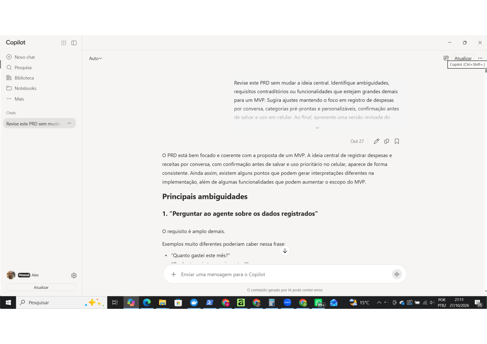
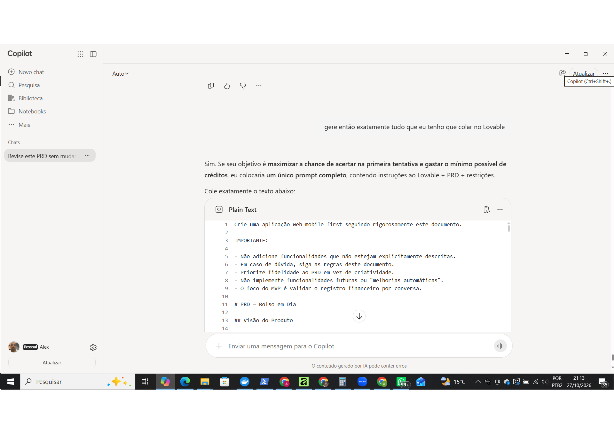
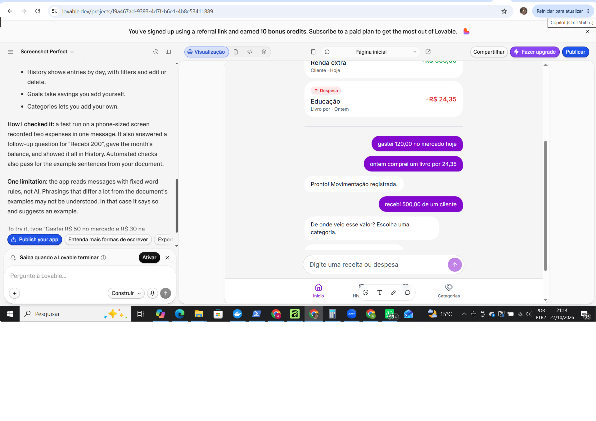
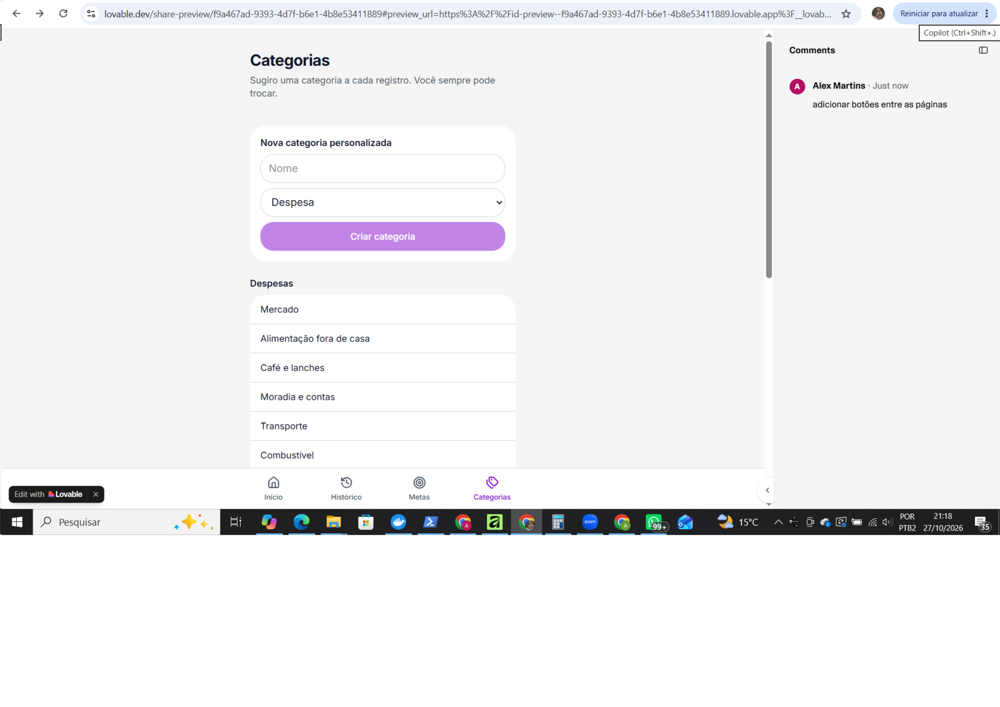

# 💸 App de Organização de Finanças Pessoais com Vibe Coding

Aprenda a **criar soluções com IA** de forma criativa, guiando ferramentas como o **Copilot** e o **Lovable** com uma comunicação simples e natural. O foco é desenvolver o conceito de um **App de Organização de Finanças Pessoais**, mas, acima de tudo, aprender o **jeito Vibe de programar com IA**.

## ✨ O que é Vibe Coding

**Vibe Coding** é uma forma leve e criativa de desenvolver com IA, baseada em **conversas naturais e bem estruturadas**. Você não precisa escrever código linha por linha. Em vez disso, aprende a **guiar a IA** descrevendo suas ideias de forma clara, com **intenção e contexto**. Em outras palavras:

> Você mostra a vibe da sua ideia e a IA transforma em solução (ou em um caminho para ela).

## 🎯 Desafio

Problema: Muitas pessoas não conseguem manter um controle financeiro porque os aplicativos exigem muita entrada de dados manual, e a criação de orçamentos é vista como algo tedioso. 

Precisamos de uma solução que permita **controlar as finanças por meio de uma conversa simples**, com **agentes de IA** capazes de criar **planos de economia personalizados e automatizados**. Você deve utilizar as ideias de **Vibe Coding** e **MVP (Produto Mínimo Viável)** para desenvolver o **conceito de um aplicativo** que resolva o problema citado.

> [!IMPORTANT]
> Você **não precisa construir o código**! O foco está em **usar a IA como sua parceira criativa**, transformando boas ideias e prompts em conceitos funcionais que simulam um produto real.

## 🪄 Etapas do Desafio

### 1. Saber o que Pedir é a Chave! Otimize seus Prompts!

Antes de pedir para a IA "criar um app", é importante definir com clareza o que você quer construir e por quê. Para isso, você vai criar um **PRD (Product Requirements Document)** simplificado, uma especificação que serve como _briefing_ para a IA entender sua ideia.

Um bom PRD deve descrever o problema, quem será beneficiado, as principais funcionalidades e o que você espera que a IA entregue. Use o modelo abaixo como ponto de partida e adapte conforme o seu estilo:

```txt
# Contexto
Quero criar um aplicativo de Organização de Finanças Pessoais que funcione por meio de conversas com o usuário.  
A ideia é facilitar o controle financeiro de forma simples e natural, sem formulários manuais ou planilhas complexas.

# Problema
Muitas pessoas desistem de controlar seus gastos porque os apps atuais exigem muita entrada manual e pouca personalização.  
Quero resolver isso com uma experiência de conversa e recomendações automáticas de economia.

# Público-Alvo
Pessoas que querem começar a organizar suas finanças de forma prática e sem complicação, principalmente iniciantes.

# Funcionalidades-Chave
1. Registrar gastos via chat em linguagem natural.  
2. Classificar automaticamente as transações.  
3. Definir e acompanhar metas financeiras.  
4. Receber dicas de economia do “Agente Financeiro”.  
5. Visualizar relatórios simples e personalizados.

# Entregável da IA
Gerar um plano de MVP com as principais telas, recursos necessários e um esboço de validação inicial.  
Usar tom educativo e linguagem acessível, em português.
```

Depois de preencher o modelo, use o Copilot Web para revisar e melhorar o seu prompt antes de ir ao Lovable. A ideia é lapidar o texto até que ele fique claro, direto e reflita exatamente a sua intenção.

> [!TIP]
> Pense no PRD/Prompt como “o briefing que a IA precisa para entender sua vibe”. Portanto, quanto mais claro e intencional for o texto, mais próximas do ideal serão as respostas da IA.

### 2. Explorando o Lovable na Prática

Com seu PRD pronto e revisado, é hora de colocar a IA em ação. Abra o Lovable, cole seu prompt completo e peça o plano inicial do MVP do seu aplicativo. Como o plano gratuito limita você a 5 interações por dia, seja estratégico:
- Faça perguntas diretas e construtivas, como “crie o fluxo de telas com base nas funcionalidades listadas” ou “gere uma versão resumida do plano de MVP”;
- Priorize clareza nas instruções para aproveitar ao máximo cada resposta;

Durante essa etapa, você pode orientar a IA para três entregas principais:
1. Agente Financeiro: defina o comportamento e o tom de voz de um consultor financeiro pessoal, alinhado ao público e objetivo do app.
2. Fluxo de Telas: peça à IA para gerar o fluxo conceitual de telas com base nas funcionalidades descritas no PRD, simulando a interação por conversa.
3. Plano de MVP: solicite um resumo das 5 funcionalidades principais, dos recursos necessários e um plano de validação inicial (como medir se o app cumpre seu propósito).

> [!TIP]
> Se preferir, você pode fazer tudo com o **Copilot**. O importante é exercitar a habilidade de transformar intenções em instruções claras e testar os limites da IA como parceira criativa.

### 3. Entregando o Desafio na DIO

Finalize seu projeto criando um **repositório no GitHub** (pode ser um **fork** deste).  
No README do seu repositório, inclua:

- Seu **prompt final** (PRD);  
- Prints ou pequenos vídeos das interações com a IA;  
- Um resumo do que o seu **App de Finanças Pessoais** faz;  
- Uma breve **reflexão sobre o processo**:
  - O que funcionou bem?  
  - O que não funcionou como o esperado?  
  - O que aprendeu sobre conversar com IAs?

> [!TIP]
> Publique seu repositório e compartilhe o link na plataforma da DIO! Sua entrega é a prova de que você domina o raciocínio de Vibe Coding, mesmo sem escrever uma única linha de código.

## 💬 Conclusão

Vibe Coding é sobre clareza, curiosidade e criatividade, não sobre perfeição técnica. O verdadeiro objetivo aqui é aprender a pensar junto com a IA, transformando ideias em conceitos reais e enxergando a tecnologia como uma extensão do seu raciocínio criativo. Cada interação é um experimento, quanto mais clara for sua intenção, mais surpreendente será o resultado.

Bolso em Dia
Sobre o projeto
Aplicativo web mobile first de organização financeira pessoal. A proposta é permitir o registro de receitas e despesas por conversa, com confirmação antes de salvar, categorias e acompanhamento de uma meta de economia.

PRD final Bolso em Dia
Crie uma aplicação web mobile first seguindo rigorosamente este documento.

IMPORTANTE:

- Não adicione funcionalidades que não estejam explicitamente descritas.
- Em caso de dúvida, siga as regras deste documento.
- Priorize fidelidade ao PRD em vez de criatividade.
- Não implemente funcionalidades futuras ou "melhorias automáticas".
- O foco do MVP é validar o registro financeiro por conversa.

# PRD — Bolso em Dia

## Visão do Produto

O Bolso em Dia é um aplicativo mobile first de organização financeira pessoal.

A proposta principal é permitir que uma pessoa registre receitas e despesas usando linguagem natural em uma conversa simples, sem a necessidade de preencher formulários complexos.

O foco deste MVP é validar se o registro financeiro por conversa torna o acompanhamento financeiro mais fácil, rápido e acessível para usuários iniciantes.

Este MVP será uma aplicação funcional simplificada, criada para validar a experiência principal de:

- registrar movimentações por conversa;
- sugerir categorias;
- confirmar antes de salvar;
- consultar histórico;
- acompanhar uma meta simples de economia.

O produto não pretende reproduzir um sistema financeiro completo nesta fase.

---

## Problema

Muitas pessoas deixam de acompanhar suas finanças porque:

- registrar gastos parece trabalhoso;
- aplicativos financeiros podem ser complexos;
- criar um orçamento exige conhecimento ou esforço excessivo;
- preencher formulários longos causa desmotivação.

O Bolso em Dia busca reduzir essa fricção transformando o registro financeiro em uma conversa simples.

---

## Público-Alvo

Pessoas que desejam começar a organizar suas finanças pessoais, especialmente:

- usuários que utilizam principalmente o celular;
- pessoas sem experiência em finanças;
- usuários que preferem conversar a preencher formulários;
- pessoas que procuram simplicidade e praticidade.

---

## Objetivo do MVP

Validar se a combinação de:

- registro por conversa;
- categorização simplificada;
- confirmação antes do salvamento;
- visualização clara dos dados;

aumenta a facilidade de uso e o engajamento com o controle financeiro pessoal.

---

## Premissas do MVP

### Autenticação

Não haverá login.

O usuário começa a utilizar o aplicativo imediatamente.

### Armazenamento

Para este MVP:

- armazenar dados localmente no navegador;
- não utilizar backend;
- não utilizar banco de dados remoto;
- não utilizar autenticação;
- não utilizar sincronização entre dispositivos.

Caso o usuário limpe os dados do navegador, as informações serão perdidas.

---

## Princípios da Experiência

O produto deve ser:

- mobile first;
- simples;
- conversacional;
- acolhedor;
- não julgador;
- fácil de usar com uma mão.

Além disso:

- registrar uma movimentação deve exigir o menor número possível de interações;
- toda movimentação deve ser confirmada antes de ser salva;
- toda movimentação pode ser editada ou excluída posteriormente;
- o usuário mantém controle total sobre seus dados;
- o agente nunca toma decisões silenciosamente.

---

## Categorias

### Despesas

- Mercado
- Alimentação fora de casa
- Café e lanches
- Moradia e contas
- Transporte
- Combustível
- Saúde
- Educação
- Cuidados familiares
- Lazer
- Compras
- Assinaturas
- Outros

Cuidados familiares representa gastos relacionados a dependentes ou familiares que não se encaixem claramente em saúde, educação, alimentação ou outras categorias existentes.

### Receitas

- Salário
- Renda extra
- Benefício
- Reembolso
- Outras receitas

### Regras

- O sistema sugere uma categoria.
- O usuário pode alterar a categoria sugerida.
- O sistema não cria categorias automaticamente.
- O usuário pode criar categorias personalizadas.
- Categorias personalizadas são opcionais.

---

## Modelo de Dados

### Transaction

- id
- type (income | expense)
- amount
- category
- description (optional)
- date
- createdAt
- updatedAt

### Category

- id
- name
- type
- isCustom

### Goal

- id
- name
- targetAmount
- currentAmount
- targetDate (optional)
- status

### GoalContribution

- id
- goalId
- amount
- date
- description (optional)

---

## Fluxo Principal

### Tela Inicial

Ao abrir o aplicativo, o usuário visualiza:

- resumo financeiro do mês;
- histórico recente;
- campo de conversa.

Se não houver dados:

- mostrar uma explicação simples sobre como começar.

---

### Registro por Conversa

Exemplos:

"Gastei R$ 35 no almoço"

"Recebi R$ 500 de um freela"

"Paguei R$ 120 de gasolina ontem"

O sistema deve identificar:

- tipo da movimentação;
- valor;
- categoria sugerida;
- data;
- descrição quando possível.

---

## Tratamento de Ambiguidades

Quando não houver confiança suficiente para interpretar uma mensagem, o sistema deve solicitar esclarecimentos.

Exemplos:

"Recebi 200"

"Transferência de 300"

"Mercado ontem"

"Dia 5"

Casos considerados ambíguos:

- tipo não identificado;
- valor não identificado;
- data não identificada;
- data com múltiplas interpretações;
- mensagens que possam representar mais de um significado.

Mensagens contendo:

- PIX
- transferência
- TED
- movimentação

não devem ser classificadas automaticamente como receita ou despesa.

---

## Datas

O sistema deve reconhecer datas em linguagem natural.

Exemplos:

- ontem
- domingo
- dia 5

Regras:

- quando houver apenas uma interpretação possível, utilizar a data identificada;
- quando houver múltiplas interpretações, pedir esclarecimento;
- exibir a data na confirmação;
- permitir correção antes do salvamento;
- utilizar a data atual quando nenhuma data for informada.

---

## Confirmação Obrigatória

Antes de salvar:

Despesa identificada

Valor: R$ 32,00
Categoria: Alimentação fora de casa
Data: Hoje

Registrar?

Opções:

- Confirmar
- Editar
- Cancelar

Nenhuma movimentação é salva sem confirmação.

---

## Múltiplas Movimentações

Exemplo:

"Gastei R$ 50 no mercado e R$ 30 na farmácia"

O sistema apresenta:

Identifiquei 2 movimentações

1. Mercado - R$ 50
2. Saúde - R$ 30

Fluxo:

- permitir editar cada item;
- permitir remover cada item;
- permitir confirmar apenas os itens desejados;
- salvar somente os itens confirmados.

---

## Descrição das Transações

Exemplo:

"Gastei R$ 80 no restaurante japonês Sapporo"

Resultado:

Categoria:
Alimentação fora de casa

Descrição:
Restaurante japonês Sapporo

Regras:

- descrição é opcional;
- o sistema tenta identificá-la automaticamente;
- o usuário pode editar ou remover a descrição.

---

## Resumo Financeiro

O resumo deve representar apenas o mês atual.

Exibir:

- Receitas do mês
- Despesas do mês
- Saldo do mês até o momento

Cálculo:

Saldo do mês =
Receitas do mês - Despesas do mês

Exemplo:

Receitas:
R$ 5.000

Despesas:
R$ 2.000

Saldo do mês:
R$ 3.000

---

## Histórico

Exibir agrupado por dia.

Exemplo:

Hoje

[Despesa]
Mercado
-R$ 80

[Despesa]
Café
-R$ 12

Total de despesas do dia:
R$ 92

Exemplo de receita:

[Receita]
Freelance
+R$ 500

Não depender somente das cores para diferenciar receitas e despesas.

Utilizar:

- rótulos;
- sinais positivos e negativos;
- ícones.

### Filtros

- Todos
- Receitas
- Despesas
- Categorias
- Mês

---

## Edição

Ao tocar em uma transação:

- visualizar detalhes;
- editar;
- excluir.

### Edição por formulário

Campos:

- valor;
- categoria;
- data;
- descrição.

### Edição por conversa

Exemplos:

"Troque para R$ 180"

"Mude para Mercado"

"Foi ontem"

Toda alteração exige confirmação.

---

## Metas

O MVP suportará apenas metas com aportes manuais.

Criar meta com:

- nome;
- valor alvo;
- data alvo opcional.

Exemplo:

Meta: Viagem
Objetivo: R$ 5.000

Adicionar aporte:

"Adicionar R$ 300 à meta Viagem"

O progresso da meta é calculado exclusivamente pelos aportes registrados.

---

## Consultas Suportadas

Exemplos:

"Quanto gastei este mês?"

"Qual meu saldo do mês?"

"Quanto gastei com mercado?"

"Como está minha meta?"

Consultas suportadas:

- saldo do mês;
- total de receitas;
- total de despesas;
- gastos por categoria;
- progresso da meta.

Todas as respostas devem ser calculadas com base nos dados realmente armazenados.

Nunca inventar dados.

---

## Comportamento do Agente

O agente deve ser:

- claro;
- breve;
- educado;
- acolhedor;
- não julgador.

Deve:

- confirmar ambiguidades;
- explicar cálculos quando solicitado;
- aceitar correções sem insistência.

Não deve:

- recomendar investimentos;
- fornecer consultoria financeira;
- repreender gastos;
- inventar informações.

---

## Navegação

Barra inferior fixa:

- Início
- Histórico
- Metas
- Categorias

---

## Tela Inicial

Estrutura desejada:

Resumo Financeiro

Receitas
Despesas
Saldo do mês

----------------

Digite uma receita ou despesa

[Campo de mensagem fixo]

A conversa deve permanecer acessível diretamente na tela inicial.

Não exigir mudança de tela para registrar uma movimentação.

---

## Diretrizes Visuais

Visual minimalista.

Objetivos:

- simplicidade;
- clareza;
- leitura rápida;
- foco mobile;
- poucos elementos por tela.

Usar:

- bastante espaço em branco;
- cartões simples;
- tipografia legível;
- hierarquia visual forte.

Paleta principal:

Roxo principal:
#820AD1

Roxo secundário:
#9B3CF0

Roxo escuro:
#6D28D9

Neutros:

#FFFFFF
#F5F5F5
#D1D5DB
#4B5563
#111827

Receitas:
#16A34A

Despesas:
#DC2626

As cores não devem ser o único mecanismo de diferenciação.

Utilizar também:

- rótulos;
- ícones;
- indicadores textuais.

Fonte preferencial:

Inter

---

## Fora do Escopo

Não implementar:

- login;
- autenticação;
- backend;
- banco de dados remoto;
- sincronização;
- integração bancária;
- PIX;
- cartões;
- importação de extratos;
- investimentos;
- projeções financeiras;
- parcelamentos;
- recorrências;
- gráficos avançados;
- notificações;
- gamificação;
- aconselhamento financeiro.

---

## Entregável Esperado

Gerar uma aplicação web mobile first funcional contendo:

- registro de receitas e despesas por conversa;
- categorização sugerida;
- confirmação antes do salvamento;
- categorias padrão e personalizadas;
- histórico filtrável;
- edição e exclusão de movimentações;
- metas com aportes manuais;
- consultas básicas aos dados registrados;
- armazenamento local no navegador;
- interface minimalista inspirada em aplicativos financeiros modernos.

Siga rigorosamente este documento.
Não implemente funcionalidades além das descritas acima.

Interações com IA
Copilot: Escrevi um primeiro PRD, depois fui detalhando com o copilot

Lovable: Subi o PRD, as imagens estão linkadas abaixo

Validação do protótipo
Terei que adicionar botões de transições entre as telas quando tiver mais créditos, mas está funcionando como o esperado

Reflexão
Quanto mais detalhado o prompt melhor, e é preciso tomar muito cuidado com coisas básicas como ter botões para navegação entre as telas.

## Evidências do processo

### Revisão do PRD com o Copilot





### Protótipo gerado no Lovable




